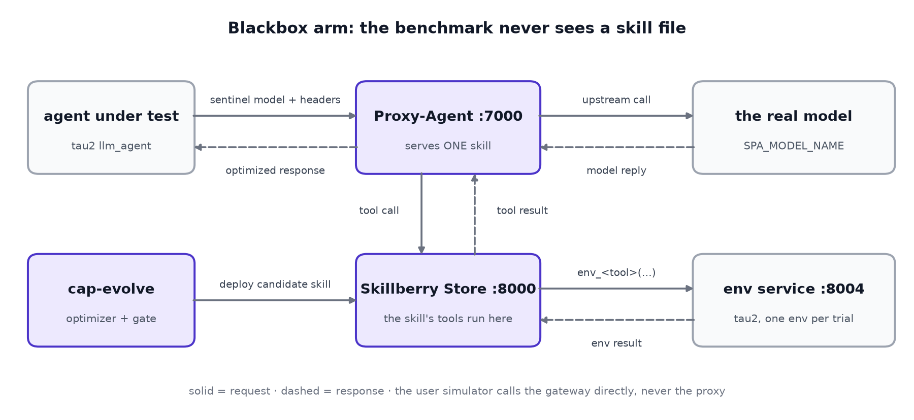
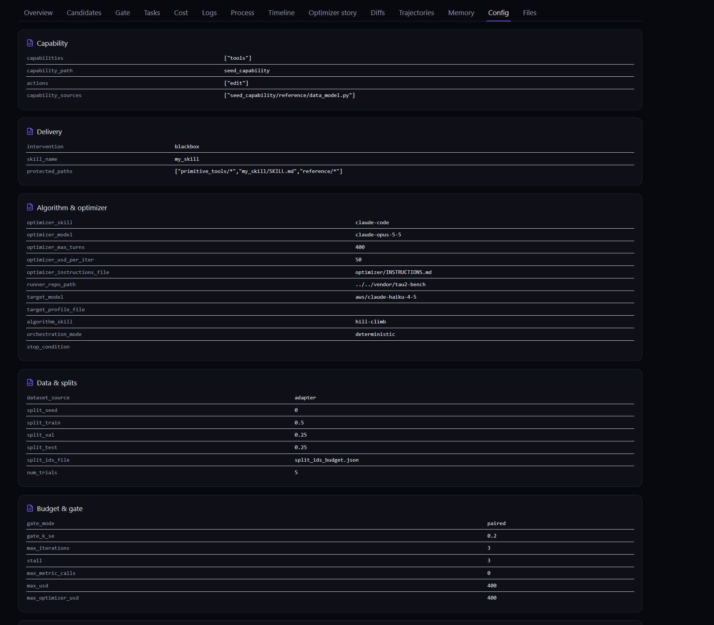
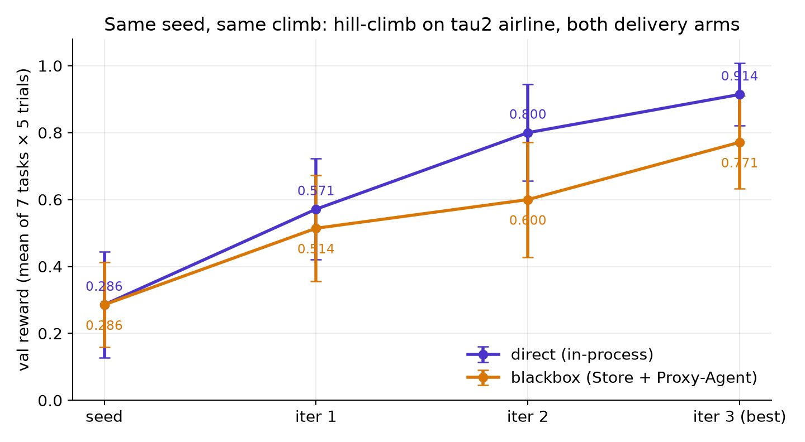
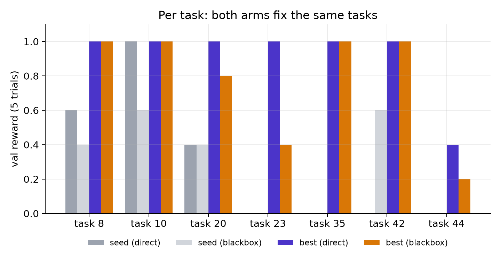
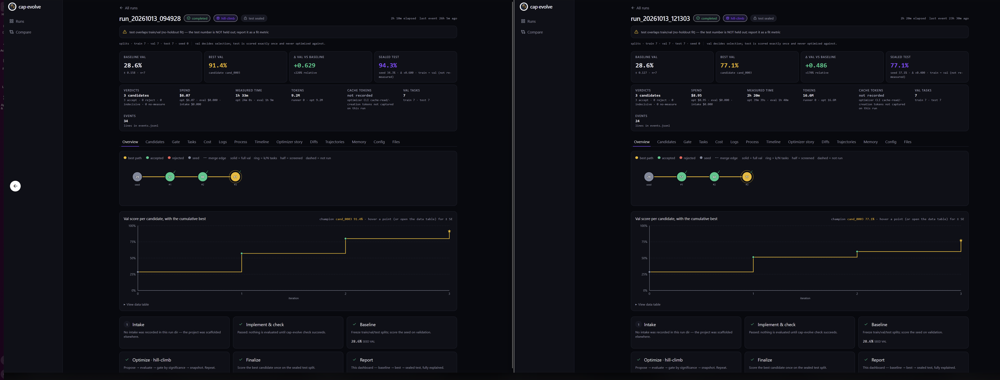
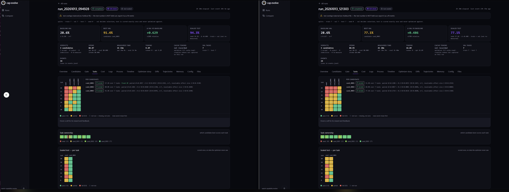
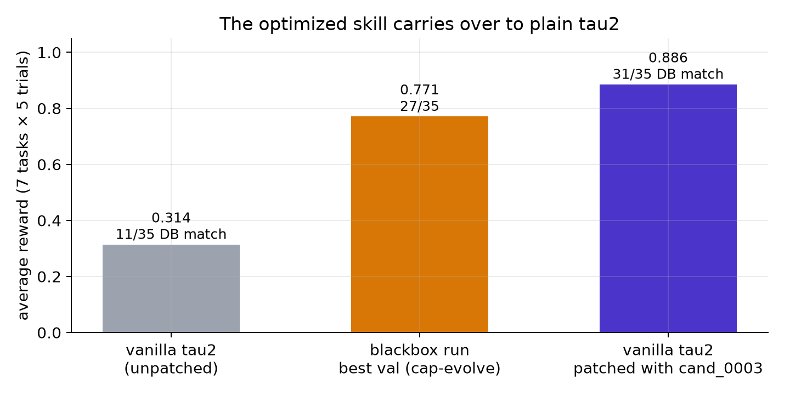

# With cap-evolve: Optimizing Agent Capabilities Without Touching the Agent or the Benchmark - the blackbox approach

*How we made cap-evolve optimize an agent's tools through the Skillberry Store and Proxy-Agent, showed it climbs the same way as in-process delivery, and moved the winning skill back into plain τ²-bench: 0.314 → 0.886.*


*Figure 1. In the blackbox approach, cap-evolve deploys each candidate to the Skillberry Store. The Proxy-Agent injects it into the agent's LLM calls, and the benchmark never sees a skill file.*

---

## TL;DR

- **cap-evolve now optimizes capabilities that reach the agent through a proxy, not as files.** With `intervention: blackbox`, each candidate becomes a skill in the Skillberry Store, and the Skillberry Proxy-Agent serves it on the agent's LLM calls. That is how Skillberry ships capabilities to a real agent.
- **It climbs like the direct approach.** On τ²-bench airline (7 tasks × 5 trials, `claude-haiku-4-5`), both approaches start from the same seed at **0.286**, accept all 3 iterations, and both end with the same best candidate id, `cand_0003`.
  - **Final val:** **0.914** for direct, **0.771** for blackbox.
  - **The gap is within noise:** the 0.14 difference is under one combined standard error.
  - **Same tasks fixed:** both approaches fix the same tasks.
- **The optimized skill carries over.** We patched the blackbox winner's tools into an unmodified τ²-bench `tools.py`, and the agent's reward on the same tasks went from **0.314 to 0.886** (p ≈ 5·10⁻⁷). The improvement comes from the candidate.

---

## Why a second delivery approach?

cap-evolve's loop is evaluate → diagnose → propose an edit → keep it only if it beats validation by a significant margin. Until now the edited capability always reached the agent the **direct** way: the benchmark's runner loads the candidate's `tools.py` (or prompt, or skill package) in its own process.

Real deployments often don't work like that. In Skillberry, an agent's skills live in a **store**, and a **proxy** in front of the model decides what the model sees:
- which tool schemas;
- which prompt enrichment;
- which tools it can call.

The agent's own code never changes. If you optimize a skill in-process and ship it through a proxy, nobody has measured the version that actually runs.

So we added a second **delivery approach**. The capability being optimized stays the same; what changes is how it reaches the model under test.

| | Direct | Blackbox |
|---|---|---|
| How the candidate reaches the agent | the runner loads the candidate's tool code in its own process | the candidate becomes a store skill; the Proxy-Agent injects it |
| What the agent calls | the gateway model | the sentinel model `ibm/skillberry-local`; the Proxy-Agent calls the real model |
| Extra services | none | Skillberry Store `:8000`, Proxy-Agent `:7000`, τ²'s environment service `:8004` |
| Spec | — | `intervention: blackbox`, `skill_name: my_skill` |

**Capability** (*what* gets edited, `capabilities:`) and **intervention** (*how* it is delivered, `intervention:`) are independent axes in the spec. The same candidate can be measured either way.

---

## How it works

**The benchmark is never edited.** We run **vanilla** `sierra-research/tau2-bench`, pinned to one commit. Everything τ² lacks for the blackbox approach is added from outside, by a tailoring module beside the adapter:
- **Sentinel routing.** Only the *agent's* LLM calls go to the Proxy-Agent. The user simulator calls the gateway directly, so only the agent under test sees the candidate.
- **Context headers** on every agent call (`skillberry-context-plugin`, `-env_id`, `-task_id`). They let the store route each tool call to the right trial.
- **An environment service.** The skill's tools run inside the store, so they reach τ²'s state over HTTP through τ²'s own `EnvironmentManager`.
- **One session per trial.** Each trial opens a remote environment (`/start_environment`), and in a `finally` closes it and the proxy session. An errored trial cleans up too.
- **Two trajectory merges, in the right windows:**
  - the environment's trajectory **before** evaluation, so the scorer replays the real database writes;
  - the proxy's trajectory **after** evaluation, so the optimizer also sees the skill's composite calls.

  Merge both after evaluation, and every trial scores 0. That looks like a bad candidate rather than a wiring bug.

**What the optimizer edits** is one skill, `my_skill`, imported into the store. Each file under `my_skill/scripts/` is one tool, and the seed's 14 files are τ²'s 14 airline tools: just the signature and docstring, calling a primitive.

```python
def get_user_details(user_id: str):
    """Get the details of a user, including their reservations. ..."""
    return env_get_user_details(user_id=user_id)
```

The 14 `env_<tool>` **primitives** are frozen: they run τ²'s real tool in the trial's environment. The optimizer rewrites tools and adds new ones, all calling primitives. It follows delivery rules that are easy to break silently:
- one public top-level `def` per file;
- the signature and docstring are the schema the model reads;
- Pydantic argument models go in the tool's own file, so the store publishes a rich schema.


*Figure 2. The run's Config tab: `intervention: blackbox`, `skill_name: my_skill`, and the sealed `protected_paths` (the primitives, `SKILL.md`, the data model).*

---

## Measurement: does the blackbox approach climb like the direct approach?

We ran the same experiment twice, once per approach, changing only the delivery:

| Setting | Value |
|---|---|
| Benchmark | τ²-bench airline, vanilla, pinned commit |
| Tasks | 7 (`8 10 20 23 35 42 44`), 5 trials each |
| Agent under test | `aws/claude-haiku-4-5` |
| User simulator | `aws/claude-sonnet-5` |
| Optimizer | Claude Code, `claude-opus-5-5`, hill-climb, 3 iterations |
| Gate | paired, accept iff Δ > 0.2·SE |


*Figure 3. Val reward per hill-climb iteration, with ±1 standard error. Both approaches start from the same seed and accept every iteration.*

| | Direct | Blackbox |
|---|---|---|
| Seed val | 0.286 | 0.286 |
| Iteration 1 | 0.571 | 0.514 |
| Iteration 2 | 0.800 | 0.600 |
| **Best val** (`cand_0003`) | **0.914** ± 0.093 | **0.771** ± 0.138 |
| Sealed test: seed → best | 0.343 → **0.943** | 0.371 → **0.771** |
| Iterations accepted | 3 / 3 | 3 / 3 |
| Optimizer spend | $6.07 | $8.95 |

**Read it as agreement, not as a race.**
- **Identical seed and acceptance:** both approaches start at exactly 0.286 and the gate accepts every iteration on both.
- **Within noise:** the final gap, 0.914 vs 0.771, is 0.14, under one combined SE (≈ 0.17).
- **The same tasks moved** (Figure 4): 8, 10, 35 and 42 reach 1.0 on both approaches, 20 rises from 0.4 to 0.8–1.0, and 44 stays the hard one on both.
- **The only visible difference is task 23** (1.0 vs 0.4). We trace it to two blackbox-specific effects below.


*Figure 4. Per-task val reward for the seed and the best candidate, on each approach. Both approaches fix the same tasks.*


*Figure 5. The two runs in the cap-evolve dashboard: direct on the left, blackbox on the right. The same lineage shape, seed → #1 → #2 → #3, all accepted.*


*Figure 6. The Tasks tab of each run: per-task, per-candidate rewards, and the sealed test per task.*

**Why blackbox reads a little lower.** Two properties of the current Skillberry stack, not of the optimization, take a few points off the blackbox approach:
- **The proxy keeps no tool results across turns.** A detail fetched in an earlier turn, such as a payment-method id, isn't in context later. The agent then refuses or asks again.
- **The store strips quotes from tool results**, which damages JSON-looking outputs.

Both are being fixed in the Skillberry stack. Section "carry-over" below shows what happens when they're out of the way.

> **Honesty note.** All three splits are the same 7 tasks (a no-holdout *fit*), and the dashboard says so. These numbers show the two approaches agree and the loop works through a proxy. They are not a held-out generalization result.

---

## Walkthrough: from an optimized store skill back to plain τ²

An optimized skill is only useful if someone can run it. So we took the blackbox winner, `cand_0003`, and put its tools into a fresh, unmodified clone of τ²-bench, changing **only** `src/tau2/domains/airline/tools.py`.

**What `cand_0003` learned.** It's a skill of 20 tools: τ²'s 14, rewritten, plus 6 new ones. For example:
- `find_same_day_reservations` groups a user's flights by day, so the agent cancels exactly the right duplicate bookings instead of juggling them by hand;
- `book_reservations_in_order` makes several bookings in a fixed order, so reservation ids are deterministic;
- `cancel_reservation` gains a check: when travel insurance is the only ground, it routes to `cancel_reservation_with_insurance(reservation_id, reason)`, which checks the reason first.

Each new check returns an `"Error: …"` string instead of acting, and the agent usually recovers.

**The patch, mechanically generated from the skill scripts:**

```python
class _AirlinePrimitives(ToolKitBase):     # τ²'s original AirlineTools, body unchanged
    ...

class AirlineTools(_AirlinePrimitives):    # what the airline environment serves to the agent
    def _prim(self, tool: str, **kwargs):
        """Run an original tool as the environment service would for env_<tool>:
        the JSON result parsed back, or an "Error: ..." string."""
        try:
            resp = getattr(_AirlinePrimitives, tool)(self, **kwargs)
        except Exception as e:
            return f"Error: {e}"
        content = Environment.to_json_str(resp)
        try:
            return json.loads(content)
        except (TypeError, ValueError):
            return content

    @is_tool(ToolType.READ)
    def find_same_day_reservations(self, user_id: str) -> Any:
        """...the candidate's docstring, verbatim..."""
        user = self._prim("get_user_details", user_id=user_id)   # was: env_get_user_details(...)
        ...
```

- **The original tools become primitives.** τ²'s `AirlineTools` is renamed `_AirlinePrimitives`, with its body unchanged, so every database read and write still runs τ²'s own code.
- **The candidate's tools become the agent's tools.** Each skill script is copied **verbatim** as a method of the new `AirlineTools`, gaining `self` and a decorator. Each `env_<tool>(…)` call becomes `self._prim("<tool>", …)`.
- **`_prim` returns what the store returned.** It gives the parsed JSON or an `"Error: …"` string, so the scripts' own checks behave as they did during optimization.
- **Pydantic models stay the candidate's.** Where its models equal τ²'s, τ²'s are used. Where they differ (two `FlightInfo` variants with sharper descriptions), they're kept verbatim, so the schema the agent sees is identical to the store's.

**Checked before running:**
- **schemas:** for all 20 tools, the schema the agent is sent equals the one built from the candidate's own script;
- **the scoring target didn't move:** τ² computes the expected database by replaying gold actions through the *same* `tools.py`. For all 7 tasks, that replay gives the same final database through the patched tools as through the originals.

**The result**, the same `tau2 run` command on both clones:

```bash
tau2 run --domain airline --task-ids 8 10 20 23 35 42 44 --num-trials 5 \
  --agent llm_agent --agent-llm openai/aws/claude-haiku-4-5 \
  --user-llm openai/aws/claude-sonnet-5 --max-concurrency 50
```


*Figure 7. The same 7 tasks × 5 trials. Unpatched τ² scores 0.314. The patched τ², running cand_0003's tools without any proxy, scores 0.886.*

| Task | Unpatched | Patched | Why |
|---|---|---|---|
| 8 | 0.20 | **1.00** | the rewritten `book_reservation` checks payment and baggage, so no more "payment does not add up" |
| 20 | 0.40 | **1.00** | `search_itineraries_by_price`; the one-certificate check refuses a bad booking and the agent retries |
| 23 | 0.00 | **0.60** | `book_reservations_in_order`, so the reservation ids match the expected database |
| 35 | 0.20 | **1.00** | `search_itineraries_by_price` |
| 42 | 0.40 | **1.00** | `find_same_day_reservations`: exactly the two right cancellations, every trial |
| 44 | 0.00 | **0.60** | `calculate_flight_change_cost` + `get_reservation_flight_times` |

**The evidence that the gain is the candidate's:**
- **The same settings and seeds:** both runs share every recorded setting and the same 5 per-trial seeds. The only difference is the code commit.
- **The candidate's tools ran:** the patched run called 6 tools that exist only in `cand_0003`.
- **The scoring target is unchanged.**
- **Not noise:** database matches went from 11/35 to 31/35, z = 4.88, one-sided p ≈ 5·10⁻⁷.

That 0.886 is *above* the blackbox run's own 0.771, because the patched agent doesn't pay the two blackbox handicaps above. It's the clearest sign that the optimization itself transfers.

---

## Try it

Everything is in the repo, and runs on any machine with `git`, `uv`, `curl` and `make`:

```bash
bash examples/tau2_sierra_airline/blackbox/setup.sh        # installs, pins tau2, provisions the stack
bash examples/tau2_sierra_airline/blackbox/run.sh --smoke  # task 9, one trial, no optimizer spend
bash examples/tau2_sierra_airline/blackbox/run.sh          # the run measured above
```

- **Step-by-step guide:** the [Blackbox tab](https://skillberry-ai.github.io/cap-evolve/blackbox.html) on the cap-evolve site, and [`docs/blackbox/`](https://github.com/skillberry-ai/cap-evolve/tree/main/docs/blackbox).
- **The direct approach, for comparison:** `examples/tau2_sierra_airline/direct/`, the same commands.
- **Onboarding your own benchmark:** the example was produced by a coding agent following one prompt, [`examples/tau2_sierra_airline/PROMPT.md`](https://github.com/skillberry-ai/cap-evolve/blob/main/examples/tau2_sierra_airline/PROMPT.md).

## What's next

- **Fixing the two blackbox handicaps** in the Skillberry stack: carrying tool results across turns, and not stripping quotes.
- **A held-out split**, so the agreement between the approaches is measured on tasks the optimizer never saw.
- **Both approaches as CI legs** (`tau2_sierra`, `tau2_sierra_blackbox`), so every change to cap-evolve is checked on both delivery paths.

*cap-evolve is open source (Apache-2.0): [github.com/skillberry-ai/cap-evolve](https://github.com/skillberry-ai/cap-evolve).*
