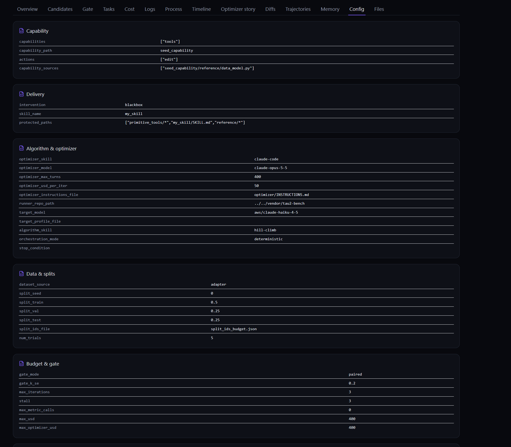

# Reading the results

## The dashboard

`run.sh` starts the dashboard and prints its URL. To open it later:

```bash
.venv/bin/cap-evolve dashboard --base .capevolve-blackbox
```

It picks a free port from `7878`, or reuses a server already serving the same base. Each run's
**Config** tab shows how the candidate was delivered, under "Delivery":
- `intervention: blackbox`;
- `skill_name: my_skill`;
- the `protected_paths`.



## The run directory

`.capevolve-blackbox/run_<ts>/`:

| Path | What it holds |
|---|---|
| `report.md`, `final.json` | baseline val → best val → sealed test, the best candidate, the test delta |
| `candidates/<id>/` | each candidate's `my_skill/`, `primitive_tools/`, `reference/` |
| `rollouts/{val,test}/<task>__<tag>__t<k>.json` | one rollout per trial, with tau2's full trace |
| `native_sims/<tag>/results_<stamp>.json` | tau2's own results file |
| `native_sims/<tag>/started_env_ids_<stamp>.txt` | one line per trial attempt: `<task_id> <seed>-<attempt> <env_id>` |
| `events.jsonl` | every evaluation, gate decision and warning |

## Blackbox checks

These hold on a correctly wired run:

- **One session per trial attempt.** In `started_env_ids_*.txt`, the lines for each
  `<task_id> <seed>` match its attempts: 7 tasks × 5 trials gives 35 lines, plus one per retry.
- **No session left open.** Every logged `env_id` answers `GET :8004/{env_id}/info` with a
  non-200, which means it was stopped.
- **The writes reach the scorer.** At least one trial has `reward_info.db_check.db_match`
  true. If it is false on every trial, see
  [Troubleshooting](06-troubleshooting.md#dbmatch-false-on-every-trial).
- **Cost.** The proxy reports no token usage, so the agent's cost and tokens read 0. A 0 means
  not measured, and `max_usd` binds only on the user simulator's cost.

## The worked run

`run_20261013_121303`: haiku-4-5 agent, 7 budget tasks × 5 trials, Claude Code optimizer, 3
hill-climb iterations.

| | Val reward |
|---|---|
| seed | 0.286 |
| cand_0001 | 0.514 |
| cand_0002 | 0.600 |
| **cand_0003** (best) | **0.771** |

Sealed test: **0.771** for cand_0003, against **0.371** for the seed.

This is a **fit**, not a held-out result: train, val and test are the same 7 tasks
(`split_ids_budget.json`). For a held-out number, pin disjoint splits.
